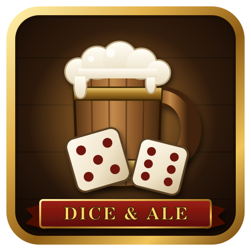

# Forever Dice & Ale

*A round of dice, a round of ale.*

The classic five-dice game for **World of Warcraft: Forever**. Play alone while you wait for your group to fill up, or pull up a chair with your party and see who buys the next round.

---

## Features

- The well-known five-dice game with five dice, three rolls per turn and 13 boxes to fill
- **Solo mode** – an unfinished game is saved and continues after `/reload` or logging out
- **Multiplayer with your party or raid** – 2 to 6 players, everyone sees every roll live
- Classic look: parchment score sheet, stone dice tray and the familiar dialog frame
- Click a box to see what it scores. Possible points are shown in green before you choose.
- English and German in game (follows your game language)

## How to play

Each turn you roll up to three times. Click dice to **hold** them between rolls. Then pick one free box on your score sheet. After 13 rounds the highest total wins.

| Box | Points |
|---|---|
| Ones – Sixes | Sum of the matching dice |
| Bonus | +35 if the upper total is 63 or more |
| Three of a Kind | Sum of all dice |
| Four of a Kind | Sum of all dice |
| Full House | 25 |
| Small Straight (4 in a row) | 30 |
| Large Straight (5 in a row) | 40 |
| Five of a Kind | 50 |
| Chance | Sum of all dice |

If no box fits, you have to enter a 0 somewhere.

## Multiplayer

1. Get into a party or raid with your friends. Everyone needs the addon.
2. One player opens **Multiplayer → Host game**.
3. Everyone else gets an invitation popup and clicks **Join**.
4. The host clicks **Start game**.

If someone leaves, the others keep playing. Players who disconnect, `/reload` or lose track of the game get it back automatically from the others. Anyone who is gone for more than a minute is skipped, and joins in again as soon as they are back.

## Commands

| Command | What it does |
|---|---|
| `/diceale` or `/dna` | Open or close the window |
| `/diceale solo` | Start a new solo game |
| `/diceale host` | Host a multiplayer game for your group |
| `/diceale join` | Join the latest invitation |
| `/diceale leave` | Leave the current game or lobby |

You can also open the window from the addon compartment menu (the button next to the minimap).

## Install

1. Install it with the CurseForge app, or download the latest zip.
2. Extract it so you have `World of Warcraft\_forever_\Interface\AddOns\ForeverDiceAndAle`.
3. Restart the game.

## How multiplayer works

There is no extra server. The addon sends small hidden addon messages over your party or raid channel. Every player's addon keeps its own copy of the game and applies the same rules, so all score sheets stay the same.

The active player rolls on their own computer. The other clients only accept moves from the player whose turn it is, and they work out the points themselves instead of trusting a number that was sent. That is fine for friendly games, but it is not built to stop someone who modifies the addon to cheat.

Every client sends a short "still here" message every 10 seconds. If a client notices it is behind, or comes back after a reload, it asks the group for the current game and gets a copy from another player.

## Made with AI

In the spirit of transparency: this addon was built with the help of AI. The code, the texts and the logo were created together with Claude (Anthropic), guided, reviewed and tested by me. If you find a bug, please open an issue – I'll take care of it.

## License

MIT – see [LICENSE](LICENSE).
